<p align="center">
  
</p>

<p align="center">
  
  
  
  
</p>

**Gulp** est une app Android qui rassemble dix petits outils du quotidien dans une seule appli : télécharger une
vidéo, convertir ou alléger un fichier, scanner un document, couper un passage, nettoyer une photo, assembler des
PDF, lire un QR code ou mesurer qui répond le plus vite sur WhatsApp. Au départ, c'était **YT Downloader**, un
simple téléchargeur vidéo ; depuis la version 1.8.0, la page d'accueil est un hub d'outils, et le dernier utilisé
s'affiche en grand.

Hormis le téléchargeur, qui va chercher la vidéo sur son site, les outils travaillent **hors ligne, sur le
téléphone** : aucun fichier n'est envoyé nulle part, et les originaux ne sont jamais modifiés.

## Trois interfaces, les mêmes outils

<p align="center">
  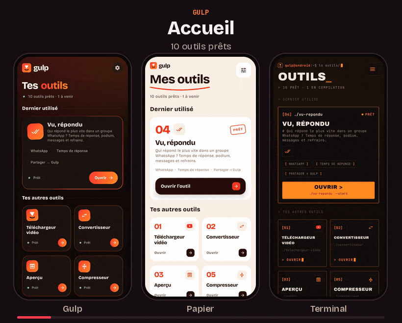
</p>

Dans **Réglages › Interface**, le changement s'applique tout de suite :

| Interface | Style |
|---|---|
| **Gulp** | sombre, dégradé rouge orangé |
| **Papier** | clair, crème et encre, typographie magazine |
| **Terminal** | console orange phosphore |

## Les dix outils

<table>
<tr>
<td width="50%" align="center" valign="top">
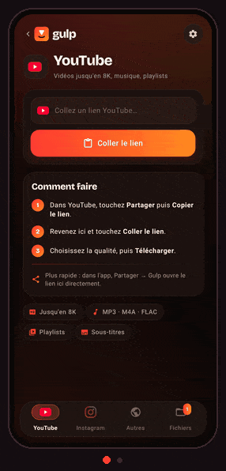<br>
<b>01 · Téléchargeur vidéo</b><br>
<sub>YouTube, Instagram, TikTok, X, Snapchat, Facebook… jusqu'en 4K / 8K / HDR, ou le son seul (M4A, MP3, Opus, FLAC). Playlists, file d'attente, enregistrement dans la Galerie.</sub>
</td>
<td width="50%" align="center" valign="top">
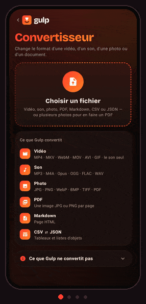<br>
<b>02 · Convertisseur</b> <sub>depuis 1.9.0</sub><br>
<sub>Vidéo (MP4, MKV, WebM, MOV, GIF…), son (MP3, FLAC, WAV…), photo (JPG, PNG, WebP, ou plusieurs photos en un PDF), PDF en images, Markdown en HTML, CSV ⇄ JSON.</sub>
</td>
</tr>
<tr>
<td align="center" valign="top">
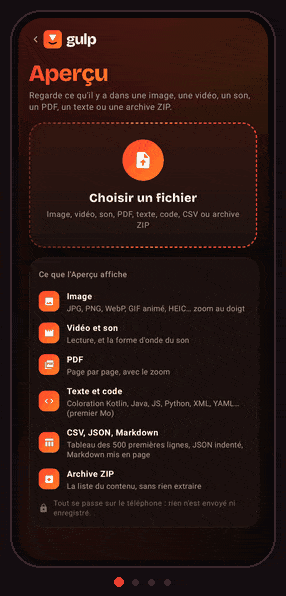<br>
<b>03 · Aperçu</b> <sub>depuis 1.9.0</sub><br>
<sub>Montre un fichier sans le modifier : photo, vidéo, son avec forme d'onde, PDF, code coloré, CSV, contenu d'un ZIP (listé, jamais extrait), empreinte SHA-256.</sub>
</td>
<td align="center" valign="top">
<br>
<b>04 · Vu, répondu</b> <sub>depuis 1.10.0</sub><br>
<sub>Une discussion WhatsApp exportée : temps de réponse moyen, podium des plus rapides, fiche par personne, stickers, heures d'activité, messages les plus répétés.</sub>
</td>
</tr>
<tr>
<td align="center" valign="top">
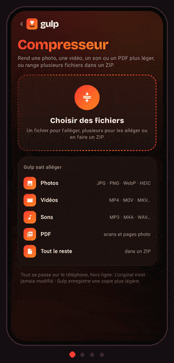<br>
<b>05 · Compresseur</b> <sub>depuis 1.11.0</sub><br>
<sub>Rend une photo, une vidéo, un son ou un PDF plus léger (Léger, Équilibré, Maxi, ou une taille cible : Discord, WhatsApp, e-mail), ou range plusieurs fichiers dans un ZIP.</sub>
</td>
<td align="center" valign="top">
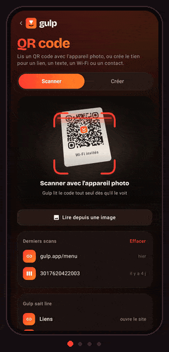<br>
<b>06 · QR code</b> <sub>depuis 1.12.0</sub><br>
<sub>Lit un QR code ou un code-barres (appareil photo ou image) et comprend un lien, un Wi-Fi, un contact… Crée aussi le sien, avec le logo Gulp au milieu.</sub>
</td>
</tr>
<tr>
<td align="center" valign="top">
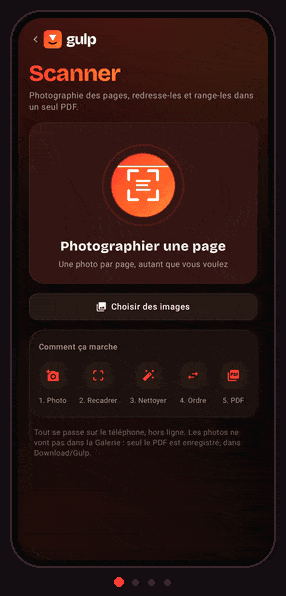<br>
<b>07 · Scanner</b> <sub>depuis 1.12.0</sub><br>
<sub>Photographie des pages : Gulp trouve la feuille, la recadre, la redresse et la nettoie (Net, Gris, Noir &amp; blanc), puis en fait un seul PDF.</sub>
</td>
<td align="center" valign="top">
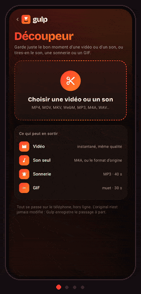<br>
<b>08 · Découpeur</b> <sub>depuis 1.13.0</sub><br>
<sub>Garde le bon moment d'une vidéo ou d'un son, au dixième de seconde, sans réencodage. Sorties : vidéo, son seul, sonnerie ou GIF.</sub>
</td>
</tr>
<tr>
<td align="center" valign="top">
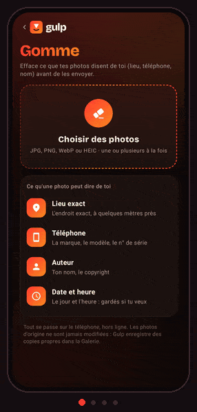<br>
<b>09 · Gomme</b> <sub>depuis 1.13.0</sub><br>
<sub>Efface ce que racontent les photos avant de les envoyer : lieu exact, téléphone, auteur, date. L'image n'est pas réencodée, Gulp en garde une copie propre.</sub>
</td>
<td align="center" valign="top">
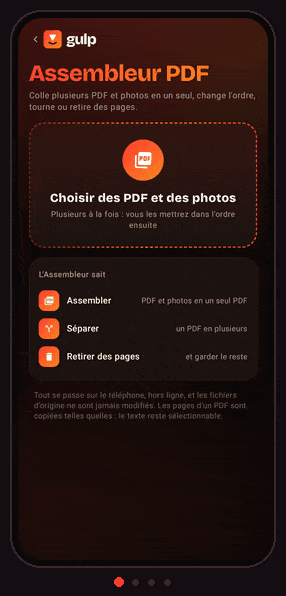<br>
<b>10 · Assembleur PDF</b> <sub>depuis 1.13.0</sub><br>
<sub>Colle plusieurs PDF et photos en un seul PDF ; les pages se tournent, se retirent et se déplacent au doigt. Sait aussi séparer un PDF.</sub>
</td>
</tr>
</table>

Le détail de chaque outil, ses formats et ses limites est dans [`android/README.md`](android/README.md) ; les
nouveautés de chaque version dans [`android/release-notes/`](android/release-notes/).

## Partager vers Gulp

Pas besoin d'ouvrir l'app d'abord : depuis YouTube, la Galerie, WhatsApp ou un gestionnaire de fichiers,
**Partager** propose **Télécharger avec Gulp**, **Convertir avec Gulp**, **Aperçu avec Gulp**,
**Compresser avec Gulp** et **Analyser avec Gulp** (pour un export WhatsApp). Gulp ouvre directement le bon outil.

## Installer

Le dépôt est **privé** : rien n'est distribué au public, et l'app n'est proposée nulle part au téléchargement.

- **APK** : chaque version publiée (tag `android-vX.Y.Z`) apparaît dans les **Releases** du dépôt, visibles par
  ceux qui y ont accès. Prendre `YT-Downloader-X.Y.Z-arm64-v8a.apk` (presque tous les téléphones récents) ou
  `-universal` en cas de doute. Les fichiers gardent l'ancien nom, et le paquet reste `com.powermaxv2.ytdownloader`,
  pour que les versions déjà installées se mettent à jour par-dessus.
- **Compiler soi-même** : JDK 17 et SDK Android (API 35) ; Android 7.0 (API 24) au minimum sur le téléphone.

  ```bash
  cd android
  ./gradlew assembleRelease
  ```

La recherche de mise à jour intégrée à l'app interroge GitHub sans compte : avec un dépôt privé, elle ne voit plus
les nouvelles versions, qu'il faut installer à la main.

## Et sur Mac ?

L'app d'origine, **YT Downloader pour macOS** (SwiftUI, version 1.3.1), est toujours dans le dépôt (`Sources/`,
`Package.swift`). Elle est restée un téléchargeur vidéo, sans les autres outils de Gulp. Installation, réglages et
sécurité : [`docs/macos.md`](docs/macos.md).

## YouTube : usage personnel

**Projet personnel.** Gulp est développé pour l'usage privé de son auteur. Le téléchargement depuis YouTube est
gardé **pour un usage personnel uniquement** : l'app n'est pas distribuée au public.

**Ce logiciel est fourni « tel quel », sans garantie, et n'est ni affilié à YouTube, Google, Meta, X, TikTok,
Snap ou BeReal, ni approuvé par eux.**

- Téléchargez uniquement des contenus dont vous détenez les droits ou dont le téléchargement est autorisé :
  vos propres vidéos, des œuvres sous licence libre (Creative Commons…) ou dans le domaine public, ou des contenus
  que leur auteur permet explicitement de télécharger.
- Les conditions d'utilisation de YouTube, d'Instagram, de Facebook, de X, de TikTok et de Snapchat interdisent en
  général le téléchargement en dehors de leurs propres fonctions. Les respecter relève de votre responsabilité.
- L'exception de copie privée ne couvre ni les copies faites à partir d'une source illicite, ni le contournement
  d'une mesure technique de protection. Elle varie selon les pays : renseignez-vous sur la loi qui vous
  est applicable.
- Ce logiciel ne contourne aucun DRM et n'en contournera pas : une vidéo protégée par DRM est refusée.
- L'auteur n'encourage aucune violation du droit d'auteur et ne peut être tenu responsable de l'usage qui est fait
  du logiciel.

Données personnelles : [PRIVACY.md](PRIVACY.md). Signaler une faille : [SECURITY.md](SECURITY.md).

## Sous le capot

| | |
|---|---|
| App Android | Kotlin, Jetpack Compose, dans [`android/`](android/) |
| Vidéo et son | yt-dlp, FFmpeg, Python et QuickJS intégrés à l'APK via [youtubedl-android](https://github.com/JunkFood02/youtubedl-android) |
| PDF | PdfBox-Android (Assembleur), rendu PDF d'Android (Aperçu, Convertisseur) |
| QR code | ZXing, CameraX |
| Polices | Bricolage Grotesque, JetBrains Mono, Archivo Black (licence OFL) |
| Captures | tests Robolectric + Roborazzi, refaites par le CI à chaque push |

Ajouter un outil : une entrée dans `ToolRegistry.tools`
([`ui/hub/Tools.kt`](android/app/src/main/java/com/powermaxv2/ytdownloader/ui/hub/Tools.kt)) avec son écran
Compose. Composants tiers et leurs licences : [THIRD_PARTY_NOTICES.md](THIRD_PARTY_NOTICES.md).

Les animations de cette page sont faites à partir des vraies captures de l'app :
[`docs/readme/fabrication/`](docs/readme/fabrication/).

## Licence

Copyright (C) 2026 powermaxv2

Ce programme est un logiciel libre : vous pouvez le redistribuer et le modifier selon les termes de la
**GNU General Public License version 3**, ou (à votre choix) toute version ultérieure, telle que publiée par la
Free Software Foundation. Il est distribué sans aucune garantie. Texte complet : [LICENSE](LICENSE).
